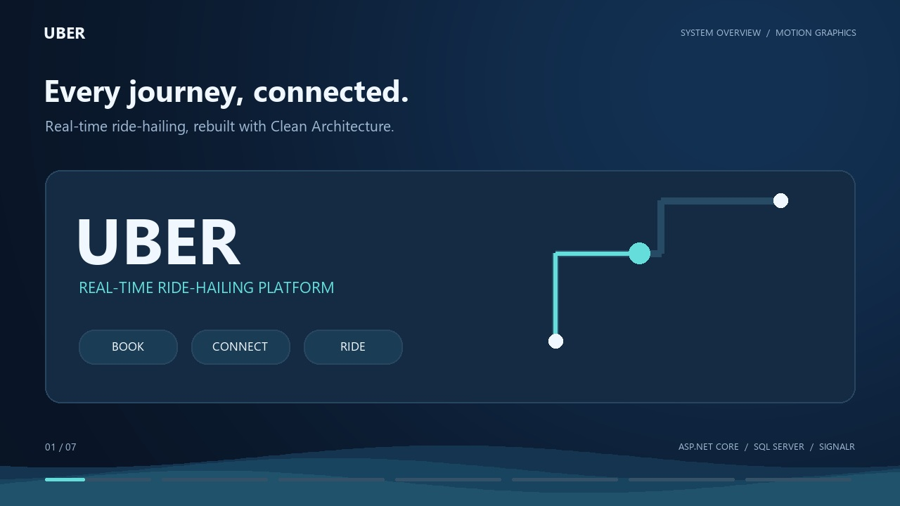
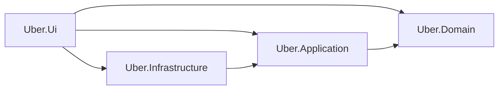
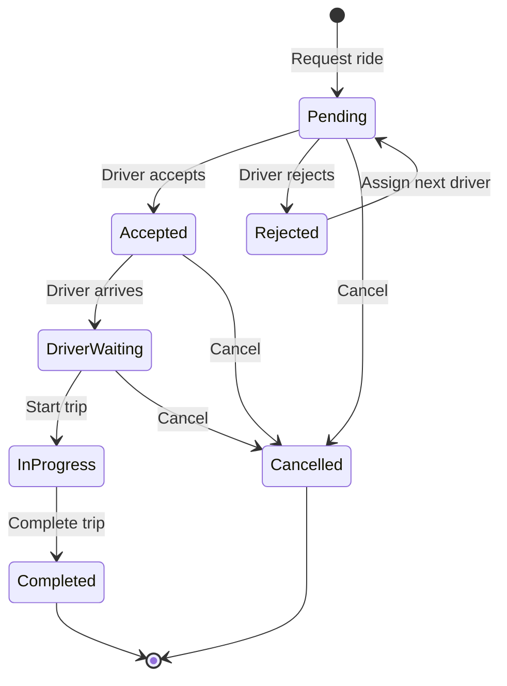

<div align="center">

<h1></h1>

**Connecting riders and drivers through real-time trip management.**

Rider and driver workflows · Live ride updates · Wallet payments · Clean Architecture

[Watch the demo](#demo) · [Get started](#getting-started) · [Explore the architecture](#architecture) · [Read the docs](#documentation)

</div>

---

## Overview

Uber System connects riders and drivers through a complete ride workflow: request a trip, match with a nearby driver, follow its progress, settle payment, and submit ratings. The application combines an MVC and Razor interface with Minimal APIs and SignalR, backed by SQL Server.

The codebase follows Clean Architecture, with domain-owned business rules, CQRS use cases, a custom mediator, and explicit persistence and integration boundaries.

## Contents

- [Demo](#demo)
- [Features](#features)
- [Technology stack](#technology-stack)
- [Architecture](#architecture)
- [Ride lifecycle](#ride-lifecycle)
- [Getting started](#getting-started)
- [Configuration](#configuration)
- [Development accounts](#development-accounts)
- [Testing](#testing)
- [Data integrity](#data-integrity)
- [Current limitations](#current-limitations)
- [Documentation](#documentation)
- [Developers and credits](#developers-and-credits)

## Demo

[](assets/demo/uber-system-overview.mp4)

**[Watch the system overview](assets/demo/uber-system-overview.mp4)** — 56 seconds · HD 720p · Motion graphics · No audio.

Explore booking, driver matching, live ride updates, wallet settlement, ratings, and the new Clean Architecture. This animated explainer illustrates the workflow and architecture; it is not a screen recording.

## Features

| Area | Capabilities |
| --- | --- |
| Ride booking | Location search, pickup and destination selection, server-calculated quotes from supplied route measurements, and nearby-driver matching. |
| Driver workflow | Accept or reject requests, report arrival, start a trip, and complete it. Rejected requests can be assigned to another driver. |
| Real-time updates | SignalR notifications for incoming requests and ride status changes. |
| Ride recovery | Restore the participant's active ride after navigation and reload persisted status after reconnecting. |
| Payments | Wallet settlement on trip completion and Stripe sandbox integration for payment workflows. |
| Ratings | Database-backed rider and driver ratings, with one rating per participant per completed ride. |
| Identity and access | ASP.NET Core Identity, role and permission checks, and optional Google and Facebook sign-in. |
| Consistency | Domain-enforced transitions, optimistic concurrency, and database constraints for active-driver reservations and duplicate ratings. |

## Technology stack

| Layer / concern | Technology |
| --- | --- |
| Runtime | C# / .NET 8 |
| Web interface | ASP.NET Core MVC, Razor views, JavaScript, Bootstrap |
| HTTP and real-time communication | Minimal APIs, SignalR |
| Application orchestration | CQRS, custom mediator, FluentValidation, Result Pattern |
| Data access | Entity Framework Core 9.0.7 for persistence; Dapper for query projections |
| Database | SQL Server |
| Authentication | ASP.NET Core Identity; optional Google and Facebook OAuth |
| Integrations | Stripe.net, SMTP |
| Tests | xUnit |

## Architecture

Dependencies point toward the application and domain layers. Infrastructure implements the contracts they define; the UI wires the implementations together at startup.



Arrows represent project references. The UI references Infrastructure as the composition root; Domain has no dependency on EF Core or ASP.NET Core Identity.

| Project | Responsibility |
| --- | --- |
| `Uber.Ui` | MVC controllers, Razor views, Minimal API endpoints, SignalR hubs, authorization, exception mapping, and startup. |
| `Uber.Application` | Commands, queries, handlers, mediator pipelines, validation, and abstractions for external services and query connections. |
| `Uber.Domain` | Entities, ride lifecycle rules, domain services, repository contracts, Unit of Work contract, and Result types. |
| `Uber.Infrastructure` | EF Core models and migrations, repository implementations, Identity, SQL connections, Stripe, and SMTP. |

Commands and queries share one SQL database. CQRS separates their responsibilities in code; it does not introduce event sourcing or separate databases.

```text
Uber/
├── src/
│   ├── Uber.Ui/
│   ├── Uber.Application/
│   ├── Uber.Domain/
│   └── Uber.Infrastructure/
├── tests/
│   ├── Uber.Domain.Tests/
│   ├── Uber.Application.Tests/
│   └── Uber.Behavior.Tests/
├── docs/
├── README.md
└── Uber.sln
```

## Ride lifecycle



The server checks participant ownership before applying a transition. Completing a ride triggers payment settlement; ratings become available after completion. See the [ride workflow guide](docs/ride-transitions-cqrs.md) for matching, recovery, and concurrency details.

## Getting started

### Prerequisites

- A .NET SDK capable of building `net8.0` projects and the .NET 8 ASP.NET Core runtime.
- SQL Server, SQL Server Express, or Windows LocalDB.
- Entity Framework CLI version `9.0.7`, matching the repository's EF Core packages.
- A browser with JavaScript enabled.

Run the following commands from the repository root. The configuration-copy example uses PowerShell.

### 1. Restore and build

```powershell
dotnet restore Uber.sln
dotnet build Uber.sln --no-restore
```

If the EF CLI is not installed:

```powershell
dotnet tool install --global dotnet-ef --version 9.0.7
```

### 2. Configure the application

Create the local settings file if it does not already exist:

```powershell
if (-not (Test-Path src/Uber.Ui/appsettings.json)) {
    Copy-Item src/Uber.Ui/appsettings.example.json src/Uber.Ui/appsettings.json
}
```

The example uses Windows LocalDB and a database named `Uber`. For another SQL Server instance, set the connection string through user secrets:

```powershell
dotnet user-secrets set "ConnectionStrings:Mydatabase" "Server=YOUR_SERVER;Database=Uber;Trusted_Connection=True;TrustServerCertificate=True" --project src/Uber.Ui
```

Configure Stripe and SMTP before exercising payment and email workflows. See [Configuration](#configuration) for the available settings. Local `appsettings.json` is ignored by Git.

### 3. Apply database migrations

```powershell
dotnet ef database update --project src/Uber.Infrastructure/Uber.Infrastructure.csproj --startup-project src/Uber.Ui/Uber.Ui.csproj
```

Apply migrations before launching the application: startup initializes Identity data and, in Development, seeds demonstration accounts.

### 4. Run locally

```powershell
dotnet dev-certs https --trust
dotnet run --project src/Uber.Ui/Uber.Ui.csproj --launch-profile https
```

Open **[https://localhost:7241](https://localhost:7241)**. The `https` launch profile sets the environment to `Development` and also binds HTTP on port `5172`.

## Configuration

Use .NET user secrets for local credentials or environment variables in your deployment environment. Nested configuration keys use `:` in user secrets and `__` in environment variables.

| Environment variable | Purpose |
| --- | --- |
| `ConnectionStrings__Mydatabase` | SQL Server connection string; required for database access and startup initialization. |
| `Stripe__SecretKey` | Stripe secret key for payment operations. Sandbox mode requires a key beginning with `sk_test_`. |
| `Stripe__UseSandbox` | Sandbox guard; defaults to `true`. The example configuration enables it. |
| `Smtp__Host`, `Smtp__Port` | SMTP server and port; the default port is `587`. |
| `Smtp__UserName`, `Smtp__Password`, `Smtp__Sender` | SMTP credentials and sender address for email workflows. |
| `Smtp__EnableSsl` | Enable SSL for SMTP; defaults to `true`. |
| `Authentication__Google__ClientId`, `Authentication__Google__ClientSecret` | Optional Google sign-in credentials; callback path: `/signin-google`. |
| `Authentication__Facebook__AppId`, `Authentication__Facebook__AppSecret` | Optional Facebook sign-in credentials; callback path: `/signin-facebook`. |

Google and Facebook authentication are registered only when both settings for the provider are populated. Register the corresponding callback URL with your provider using the application's origin.

Example local Stripe configuration:

```powershell
dotnet user-secrets set "Stripe:SecretKey" "sk_test_REPLACE_WITH_YOUR_KEY" --project src/Uber.Ui
```

Keep real credentials out of tracked configuration files.

## Development accounts

Development startup seeds the following accounts idempotently. These are local demonstration credentials; the development seeder is not executed in other environments.

| Role | Email | Password |
| --- | --- | --- |
| Admin | `admin@uber.local` | `Admin123!` |
| Rider | `rider1@uber.local` | `Rider123!` |
| Rider | `rider2@uber.local` | `Rider123!` |
| Driver | `driver1@uber.local` | `Driver123!` |
| Driver | `driver2@uber.local` | `Driver123!` |

Driver accounts include active Cairo locations and sample vehicles. Rider accounts include development wallet balances. Use separate browser sessions for a rider and driver to explore the request and acceptance flow.

## Testing

After building the solution:

```powershell
dotnet test Uber.sln --no-build
```

| Test project | Focus |
| --- | --- |
| `Uber.Domain.Tests` | Result contracts, ride rules, and payment behavior. |
| `Uber.Application.Tests` | Mediator dispatch and pipeline behavior. |
| `Uber.Behavior.Tests` | Persistence model and SQL schema baseline checks. |

These focused tests do not require a running SQL Server instance or external services. They do not replace a full browser and integration check of booking, SignalR, Stripe, and SMTP workflows.

## Data integrity

- **Valid transitions:** Domain entities reject invalid ride lifecycle changes without mutating their state.
- **Exclusive driver reservation:** A filtered unique index on `Rides.DriverId` covers `Accepted`, `DriverWaiting`, and `InProgress`, preventing concurrent accepted or ongoing rides for one driver. Pending invitations are outside this constraint.
- **Optimistic concurrency:** SQL `rowversion` tokens protect ride and user updates, including wallet and aggregate-rating changes, from lost writes.
- **Atomic wallet settlement:** Customer debit, driver credit, and ride completion are committed through one Unit of Work.
- **Persistent ratings:** A unique `(RideId, RaterId)` index prevents duplicate ratings; the rating and aggregate update are saved together.
- **Consistent error responses:** Expected business failures use Result values. The global exception handler maps concurrency and relevant unique-index races to HTTP `409 Conflict`.

## Current limitations

The [ride workflow guide](docs/ride-transitions-cqrs.md#current-follow-up-work) records these follow-up areas:

- Route distance and duration are supplied by the client; a trusted server-side routing provider should calculate them.
- Stale pending requests need an explicit background expiration or reassignment policy.
- Rejection history needs persistence to prevent a ride from cycling back to a driver who already rejected it.

## Documentation

| Guide | What it covers |
| --- | --- |
| [Clean Architecture migration](docs/clean-architecture-migration.md) | Migration plan and architectural changes. |
| [CQRS and mediator](docs/cqrs.md) | Commands, queries, handler discovery, and pipelines. |
| [Domain boundaries](docs/domain-boundaries.md) | Domain responsibilities and persistence separation. |
| [Result Pattern](docs/result-pattern.md) | Explicit success and failure contracts. |
| [Ride workflow and integrity](docs/ride-transitions-cqrs.md) | Lifecycle transitions, matching, payment, ratings, and concurrency. |
| [Behavior baseline](docs/ride-behavior-baseline.md) | Reference behavior used during the migration. |

## Developers and credits

Originally developed by:

- **[Ibrahim](https://github.com/Ibrahim-357)**
- **[Amr](https://github.com/AmrAhmed22)**
- **[Esraa Hussien](https://github.com/esraahussie)**

Thank you to everyone who contributed to the original application. See the [full contributor history](https://github.com/iTz-DESPERADO/Uber/graphs/contributors).

**Refactored by [DESPERADO](https://github.com/iTz-DESPERADO)** — Clean Architecture migration, CQRS and mediator pipelines, domain rules, and ride data integrity improvements.

---

<div align="center">

### Enjoyed this project? Give it a star ⭐

If you find this repository useful, consider starring it on GitHub to support the developers and help others discover it.

[**Star this repository**](https://github.com/iTz-DESPERADO/Uber)

</div>
